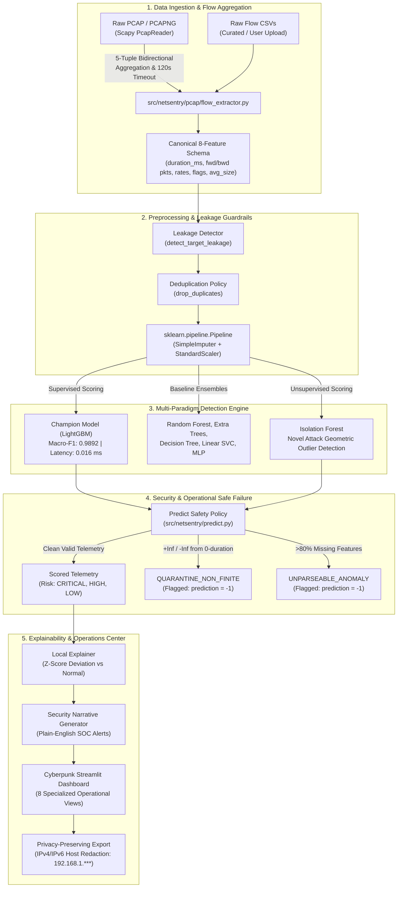

# NetSentry AI — Machine Learning Network Intrusion Detection & Research Platform

[](https://www.python.org/)
[](https://opensource.org/licenses/MIT)
[](https://streamlit.io/)
[]()
[]()
[]()

> **NetSentry AI** is an academic research and engineering platform exploring machine learning for network intrusion detection (NIDS). Developed by a third-year B.Tech Information Science and Engineering student at NMAM Institute of Technology, Nitte, NetSentry AI bridges **Data Communication & Networking (DCN)** flow telemetry with **Machine Learning (ML)** engineering. It provides offline PCAP packet ingestion, leakage-free model pipelines, cross-dataset generalization experiments, physical robustness stress-testing, and an interactive Streamlit Security Operations Center (SOC) dashboard.

---

## 📌 Problem Statement & Why NIDS Matters

Modern enterprise networks process tens of gigabits per second. Network intrusion detection systems face three fundamental engineering and data science challenges:
1. **Payload Encryption:** Over 85% of web and enterprise traffic uses TLS 1.3 or HTTPS. Deep Packet Inspection (DPI) of payload contents is computationally prohibitive and blocked by end-to-end encryption. Modern detectors must evaluate statistical **L3/L4 bidirectional flow metadata** (durations, packet sizes, inter-arrival times, TCP flags) without payload decryption.
2. **The Base-Rate Fallacy & Alert Fatigue:** In production, malicious flows represent $< 0.1\%$ of all packets. A model with an apparently stellar 99% accuracy and 1.5% False Positive Rate produces **over 94% false alarms** in live deployment, overwhelming SOC analysts.
3. **Dataset Drift & Measurement Noise:** Academic benchmarks often fail to generalize to live networks due to differing testbed configurations (concept inversion) and extreme sensitivity to physical network timing jitter.

NetSentry AI was built to investigate these challenges empirically, measure where models break, and enforce rigorous data isolation and safe failure behaviors.

---

## 🏗️ System Architecture

The following Mermaid diagram illustrates the end-to-end data processing, feature engineering, inference, and explainability architecture implemented in the repository:



---

## 💻 Technology Stack & Directory Structure

- **Languages & Frameworks:** Python 3.12, Streamlit, HTML5/CSS3 (Cyberpunk custom dark design)
- **Machine Learning & Data:** scikit-learn, LightGBM, XGBoost, pandas, NumPy
- **Networking & Packet Inspection:** Scapy (offline PCAP streaming iterator)
- **Explainability & Visualization:** SHAP, Plotly, custom forensic deviation waterfall renderers
- **Testing & Quality Assurance:** Python `unittest` (63 automated tests, 100% passing)

```
netsentry-ai/
├── app/                              # Streamlit Executive Research Web UI
│   ├── main.py                       # Main application entrypoint
│   ├── styles.py                     # Cyberpunk dark navy CSS & custom KPI widgets
│   └── views/                        # 8 Modular operational view interfaces
│       ├── overview.py               # Platform KPIs, engine status, baseline comparison
│       ├── model_lab.py              # Interactive training workbench (11 algorithms)
│       ├── traffic_analyzer.py       # Live flow scoring, offline PCAP parsing, IP privacy export
│       ├── explorer.py               # Exploratory data analysis, 5-tuples, schema audit
│       ├── research.py               # Cross-dataset generalization, unseen attacks, drift
│       ├── evaluation.py             # Confusion matrices, ROC/PR curves, threshold tuning
│       ├── explainability.py         # Global Tree MDI / SHAP, local z-score explanations
│       └── robustness.py             # Empirical stress testing & perturbation reporting
├── src/netsentry/                    # Core Python production package
│   ├── data/                         # Data loading, leakage prevention, scientific splitting
│   ├── models/                       # Pipeline constructors across 6 algorithmic families
│   ├── training/                     # Validation-based decision threshold calibration
│   ├── evaluation/                   # Macro-F1, FPR, FNR, latency, and footprint metrics
│   ├── explainability/               # Local z-score attributions & plain-English narratives
│   ├── pcap/                         # Offline PCAP parsing & bidirectional flow extraction
│   ├── research/                     # Cross-dataset transfer, drift, and robustness tests
│   ├── predict.py                    # Inference engine with safe failure quarantine policy
│   └── utils/logging.py              # Structured logging, IP masking, credential scrubbing
├── data/sample/                      # Curated benchmark samples (CIC-IDS2017, UNSW-NB15, demo)
├── tests/                            # 63 automated unit, integration, and security tests
├── artifacts/                        # Serialized models, experiment outputs, and audit JSONs
└── docs/                             # Comprehensive research reports, guides, and runbooks
```

---

## ⚙️ Installation & Startup Instructions

### 1. Prerequisites & Virtual Environment Setup (Windows PowerShell)
```powershell
# Set execution policy if script activation is restricted:
Set-ExecutionPolicy -Scope Process -ExecutionPolicy Bypass

# Clone repository and create Python 3.12 virtual environment:
python -m venv .venv
.\.venv\Scripts\Activate.ps1

# Upgrade packaging tools and install in editable mode:
python -m pip install --upgrade pip
pip install -r requirements.txt
```

### 2. Verify Complete Test Suite (63 Tests)
Run all unit, integration, and security tests:
```powershell
.\.venv\Scripts\python.exe -m unittest discover -s tests -v
```
*Expected result: `Ran 63 tests in ~15.6s ... OK`.*

### 3. Launch the SOC Dashboard
```powershell
.\.venv\Scripts\python.exe -m streamlit run app/main.py
```
Open your browser to `http://localhost:8501`.

---

## 🌐 Deployment Modalities: Local vs GitHub vs Cloud

It is essential to understand the distinction between running the code locally, hosting the repository on GitHub, and hosting a live public web demo:

| Deployment Modality | Platform / Location | Status in Project | How It Works |
| :--- | :--- | :--- | :--- |
| **1. Local Execution** | Local PC (`localhost:8501`) | **Active & Verified** | Full functionality: offline PCAP flow extraction, model training, live CSV scoring, and local explainability. |
| **2. GitHub Source Hosting** | [GitHub Repo](https://github.com/pavan55kumar/netsentry-ai) | **Active & Verified** | Archives versioned source code, 63 regression tests, Phase 1–10 tags, and research documentation for portfolio inspection. *Note: Pushing to GitHub does not host a live running server.* |
| **3. Cloud Web App Deployment** | Streamlit Community Cloud | **Optional Step** | Hosts an interactive public URL (e.g. `https://netsentry-ai.streamlit.app`) for recruiters. Connect your GitHub repo at [share.streamlit.io](https://share.streamlit.io) with entry point `app/main.py`. |

---

## 🚀 Running Analysis & Packet Ingestion

### A. Real-Time CSV Flow Scoring (CLI)
Score incoming network flow records using the saved champion model:
```powershell
python -m netsentry.predict --data data/sample/demo_flows.csv --model artifacts/best_model.joblib --features artifacts/feature_names.json --output artifacts/predictions.csv --threshold 0.50
```

### B. Offline Packet Capture (PCAP) Ingestion
In the Streamlit UI (**Traffic Analyzer** tab) or via Python API:
```python
from netsentry.pcap.flow_extractor import extract_flows_from_pcap

# Ingest raw PCAP file and aggregate into 5-tuple bidirectional flows
result = extract_flows_from_pcap("data/sample/test_traffic.pcap")
print(f"Read {result.total_packets_read} packets -> Extracted {result.total_flows_extracted} flows.")
df_flows = result.flow_dataframe
```

---

## 📊 Key Research Findings & Benchmarks

All metrics below are independently traced to serialized experiment outputs in `artifacts/`:

### 1. Model Hierarchy on Clean Holdout Split (CIC-IDS2017 Stratified Sample, 5,000 flows)
*Source: `artifacts/phase6_experiment_results.json`*

| Algorithm | Paradigm | Macro-F1 | Accuracy | FPR | Malicious Recall | Latency | Disk Footprint |
| :--- | :--- | :--- | :--- | :--- | :--- | :--- | :--- |
| **LightGBM (Champion)** | Boosting Ensemble | **0.9892** | **98.96%** | **1.59%** | **99.33%** | 0.016 ms | 344 KB |
| **Random Forest (500 trees)** | Bagging Ensemble | **0.9767** | **97.76%** | **2.59%** | **97.99%** | 0.188 ms | 1,508 KB |
| **Decision Tree (CART)** | Single Rule Tree | **0.9808** | **98.16%** | **2.79%** | **98.80%** | **0.005 ms** | **15 KB** |
| **Logistic Regression** | Linear Boundary | **0.8886** | **89.28%** | **12.95%** | **90.78%** | 0.004 ms | 6 KB |
| **Isolation Forest** | Unsupervised Anomaly| 0.3808 | 42.96% | 11.55% | 12.86% | 0.036 ms | 851 KB |

### 2. Cross-Dataset Generalization & Concept Inversion
*Source: `artifacts/phase6_experiment_results.json` (`part3_generalization_strategies`)*
- **The Collapse:** Training on CIC-IDS2017 and evaluating on untouched UNSW-NB15 holdouts drops Macro-F1 from **0.9488 to 0.3148** (a 66.82% degradation).
- **The Cause (Concept Inversion):** Attack flows in CIC-IDS2017 are long-duration volumetric DoS floods, whereas in UNSW-NB15 they are sub-second automated exploit bursts. Decision trees heavily rely on duration, misclassifying target attacks as normal traffic.
- **The Resolution (Joint Multi-Domain Training):** Training on mixed source partitions from both domains exposes the classifier to diverse backgrounds, elevating cross-domain holdout Macro-F1 to **0.8932** (+0.5784 gain).

### 3. Empirical Robustness Stress Testing
*Source: `artifacts/phase7_robustness_results.json`*
- **Measurement Jitter Brittleness:** Adding $\pm 5\%$ Gaussian noise to timing features collapses LightGBM Macro-F1 from **0.9892 to 0.6617**, flipping **33.12% of predictions** (405 attacks flipped to benign). Tree orthogonal hyperplanes tightly fit deterministic scripted attack intervals; small noise pushes samples across the decision boundary.
- **Enterprise Jumbo Frames (MTU 9000):** Scaling packet lengths to 8,960 bytes drops F1 to **0.6639** (33.28% flips), as attack signatures are masked by large segment sizes.
- **100 Gbps Burst Stability:** Rate scaling preserves **0.9850 F1** due to monotonic tree threshold saturation.
- **Adversarial Pacing:** Dilating duration 10x drops transmission rate and enables 4 attacks to evade LightGBM and 27 attacks to evade Random Forest.

---

## 📸 Application Screenshots

To capture genuine screenshots of the running dashboard:
1. Launch the dashboard: `streamlit run app/main.py`.
2. Capture the **Overview**, **Dataset Explorer**, **Traffic Analyzer**, **Research Hub**, and **Robustness** tabs using Windows Snipping Tool (`Win + Shift + S`).
3. Store PNG captures in `docs/screenshots/` (e.g. `overview_dashboard.png`, `traffic_analyzer_pcap.png`).
4. Automated verification ensures all views render without missing script context warnings.

---

## ⚠️ Scientific Limitations & Scope

To ensure intellectual honesty:
1. **Academic Research Prototype:** NetSentry AI is a research and educational platform, not an inline hardware firewall. It does not perform wire-speed kernel packet filtering.
2. **PCAP Flow Scope:** Offline PCAP ingestion aggregates the **8-feature canonical schema**. It is a functional flow ingestion demonstration, *not* an evaluation of the full 77-feature CICFlowMeter research dataset.
3. **Encrypted Payload Blindness:** Operates exclusively on L3/L4 metadata. It cannot inspect encrypted payloads (e.g. malicious HTTPS POST bodies) unless the attack causes volumetric or timing anomalies.
4. **Subsampled Repository Data:** Includes 5,000-row stratified subsamples to keep the repository lightweight. Full reproduction on 2.8M rows requires downloading external UNB datasets.

---

## 📜 Ethical & Responsible Use Statement

NetSentry AI was developed for defensive cybersecurity research, educational demonstration, and academic evaluation. 
- Only capture and analyze packet telemetry from networks you own or have explicit written authorization to monitor.
- The project implements IP privacy masking (`192.168.1.***`), secret credential scrubbing, and local temporary file deletion to protect privacy.

---

## 📚 Documentation & Reference Guides

- [Phase 9 Research & Security Audit Report](file:///c:/Users/ASUS/Documents/Codex/2026-10-25/referenced-chatgpt-conversation-this-is-an/outputs/netsentry-ai/docs/PHASE9_RESEARCH_AUDIT.md) — Comprehensive evidence-based audit.
- [Reproducibility & Replication Guide](file:///c:/Users/ASUS/Documents/Codex/2026-10-25/referenced-chatgpt-conversation-this-is-an/outputs/netsentry-ai/docs/REPRODUCIBILITY_GUIDE.md) — Exact reproduction commands, environments, and seeds.
- [Metrics Inventory & Scientific Limitations](file:///c:/Users/ASUS/Documents/Codex/2026-10-25/referenced-chatgpt-conversation-this-is-an/outputs/netsentry-ai/docs/METRICS_AND_LIMITATIONS.md) — Detailed failure analysis and metric provenance.
- [Interview & Viva Demo Runbook](file:///c:/Users/ASUS/Documents/Codex/2026-10-25/referenced-chatgpt-conversation-this-is-an/outputs/netsentry-ai/docs/DEMO_RUNBOOK.md) — 5-minute technical demo script and troubleshooting guide.
- [Technical Interview Handbook](file:///c:/Users/ASUS/Documents/Codex/2026-10-25/referenced-chatgpt-conversation-this-is-an/outputs/netsentry-ai/docs/TECHNICAL_INTERVIEW_HANDBOOK.md) — Deep-dive interview questions across ML, DCN, SWE, and Research Defense.
- [Viva & Mock Interview Pack](file:///c:/Users/ASUS/Documents/Codex/2026-10-25/referenced-chatgpt-conversation-this-is-an/outputs/netsentry-ai/docs/VIVA_AND_MOCK_INTERVIEW.md) — 75 project-specific viva questions and answer keys.
- [Portfolio Case Study](file:///c:/Users/ASUS/Documents/Codex/2026-10-25/referenced-chatgpt-conversation-this-is-an/outputs/netsentry-ai/docs/PORTFOLIO_CASE_STUDY.md) — System engineering case study for student portfolio.
- [Resume Project Entries](file:///c:/Users/ASUS/Documents/Codex/2026-10-25/referenced-chatgpt-conversation-this-is-an/outputs/netsentry-ai/docs/RESUME_PROJECT_ENTRY.md) — 2-bullet, 3-bullet, and LinkedIn project descriptions.
