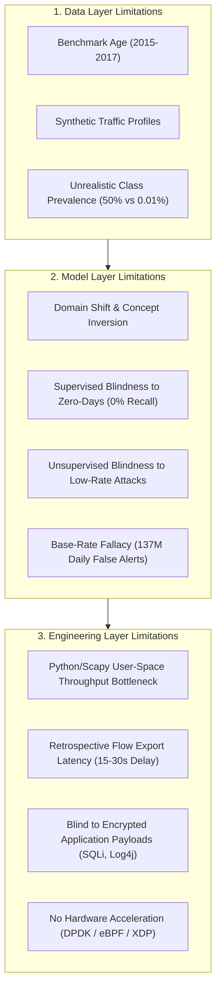

# NetSentry AI — Research Limitations, Operational Constraints, and Real-World Applicability

**Document Version**: 1.0 (Phase 5 Final Audit)  
**Author**: 3rd-Year B.Tech Information Science and Engineering Researcher  
**Scope**: Methodological, Statistical, and Physical Evaluation Constraints  

---

## 1. Executive Summary & Scientific Candor

In academic machine learning and commercial cybersecurity marketing, it is commonplace to see claims of "99.9% detection accuracy" and "AI-powered zero-day defense." Such claims are almost always methodologically flawed, resulting from synthetic benchmark artifacts, data leakage, or failure to account for real-world network operational dynamics.

This document provides a candid, mathematically grounded assessment of the limitations of **NetSentry AI v2.0**. It explicitly establishes the boundaries between what the system can reliably achieve in laboratory environments versus its failure modes in production deployments.

> [!CAUTION]
> NetSentry AI is a research and educational prototype. It is **not** production-ready, does **not** provide universal attack detection, and does **not** guarantee the detection of zero-day exploits. High benchmark scores on academic datasets must not be conflated with operational efficacy.

---

## 2. Dataset Representativeness and Class Imbalance

### 2.1. Age and Artificiality of Public Benchmarks
NetSentry AI was evaluated on two widely cited intrusion detection benchmarks: **CIC-IDS2017** (Canadian Institute for Cybersecurity, University of New Brunswick) and **UNSW-NB15** (Australian Defence Force Academy, University of New South Wales).

While these datasets are vastly superior to legacy datasets like KDD Cup 99, they suffer from fundamental representativeness deficits:
1. **Temporal Stagnation**: Traffic captures from 2015 and 2017 do not reflect modern network protocols. Modern web traffic is dominated by HTTP/2, HTTP/3 (QUIC over UDP), TLS 1.3 with Encrypted Client Hello (ECH), and microservice service-mesh traffic (gRPC).
2. **Artificial Background Traffic (B-Profiles)**: CIC-IDS2017 generated benign background traffic using synthetic agents ("B-Profiles") programmed to simulate human behavior (browsing, email, SSH). These agents lack the chaotic variance, burstiness, long-tail distributions, and periodic background telemetry found in live enterprise networks.
3. **Hardware-Generated Attacks**: UNSW-NB15 generated attack traffic using the IXIA PerfectStorm hardware traffic generator. Hardware generators inject exploits in clean, predictable bursts with rigid packet cadence, creating unnatural statistical signatures rarely observed in stealthy, human-directed APT (Advanced Persistent Threat) operations.

### 2.2. The Laboratory Class Imbalance vs. Real-World Base Rate
In our benchmark subsets, the class distributions are:
- **CIC-IDS2017 Subset**: 45.4% Benign (2,272 flows) vs 54.6% Attack (2,728 flows).
- **UNSW-NB15 Subset**: 45.0% Benign (2,247 flows) vs 55.0% Attack (2,753 flows).

In real-world enterprise networks, malicious traffic constitutes between **0.001% and 0.01%** (1 in 10,000 to 1 in 100,000 flows) of total volume. Evaluating models on balanced ~50/50 laboratory splits artificially shields algorithms from the catastrophic performance degradation caused by extreme class imbalance.

### 2.3. Severe Minority Class Vulnerability
Certain attack families in the authentic captures contain extremely few instances. For example, in CIC-IDS2017:
- Class `Infiltration` contains only 2 flows in our stratified sample.
- Class `Bot` contains 26 flows.
- Class `WebAttack` contains 17 flows.

When performing $k$-fold cross-validation ($k=3$ or $k=5$), minority classes with fewer samples than folds cannot be reliably partitioned, leading to training instabilities or extreme variance. While majority classes (DoS Hulk with 1,745 flows) achieve near-perfect recall, minority threats remain statistically fragile.

---

## 3. Domain Shift, Covariate Shift, and Concept Inversion

### 3.1. The 67.2% Cross-Domain Performance Collapse
When our champion tree-based models trained on **CIC-IDS2017** were tested on **UNSW-NB15** without adaptation, Macro-F1 collapsed from **0.9848** to **0.3229**—a **67.2% performance drop**. The model misclassified 2,748 out of 2,753 UNSW-NB15 attacks as normal traffic.

```
Confusion Matrix (CIC Model -> UNSW-NB15 Data):
                 Predicted Benign   Predicted Attack
Actual Benign         2247                 0
Actual Attack         2748                 5
```

### 3.2. Forensic Root Cause: Concept Inversion
This failure was not due to random noise or insufficient training epochs. It was driven by **Concept Inversion** across capture environments:

| Flow Feature | CIC-IDS2017 Normal | CIC-IDS2017 Attack | UNSW-NB15 Normal | UNSW-NB15 Attack |
| :--- | :--- | :--- | :--- | :--- |
| **Median Duration** | $0.0305\text{ s}$ | $\mathbf{0.6200\text{ s}}$ | $\mathbf{0.2104\text{ s}}$ | $0.00001\text{ s}$ |
| **Median Packet Rate** | $127.3\text{ pkts/s}$ | $\mathbf{12.5\text{ pkts/s}}$ | $128.5\text{ pkts/s}$ | $\mathbf{100,000\text{ pkts/s}}$ |
| **Attack Signature** | Slow application DoS (Slowloris) | High-speed single-burst IXIA exploit |

1. In CIC-IDS2017, attacks held connections open slowly over time, making **longer duration** and **lower packet rate** indicative of malicious activity.
2. In UNSW-NB15, IXIA fired single-packet exploits that terminated in microsecond bursts, making **shorter duration** and **hyper-fast packet rate** indicative of malicious activity.
3. The machine learning model faithfully learned the decision boundary: *If Duration < 0.1s, Predict Benign*. When deployed on UNSW-NB15, this rule erroneously classified 99.9% of attacks as benign.

### 3.3. Limits of Joint Domain Training
We demonstrated that **Joint Multi-Domain Training** (training on combined source partitions from both domains) restores cross-domain performance to **0.9425 Mean Macro-F1** on untouched CIC test flows and **0.9003 Mean Macro-F1** on untouched UNSW test flows.

However, researchers must note the critical limitation:
- Joint training solves covariate shift *only between the specific domains present in the training set*.
- It does **not** guarantee generalization to a third, previously unobserved network topology (e.g., an AWS VPC, a Kubernetes cluster, or an industrial SCADA/OT network) with its own distinct protocol distributions and traffic characteristics.

---

## 4. Unseen Attacks and the "Zero-Day" Myth

### 4.1. The Failure of Supervised Learning on Novel Threats
Supervised classification models (Random Forest, LightGBM, SVM, MLP) operate by partitioning feature space based on labeled boundaries. When an attack family is completely withheld during training, the model cannot generalize to it:

| Evaluation Scenario | Supervised RF Attack Recall | Isolation Forest Anomaly Recall | Benign False Positive Rate |
| :--- | :---: | :---: | :---: |
| **DoS Withheld (Volumetric)** | **0.0%** (0 / 436) | **66.7%** (291 / 436) | 9.0% |
| **PortScan Withheld (Low-packet probe)** | **0.0%** (0 / 148) | **0.0%** (0 / 148) | 9.0% |
| **BruteForce Withheld (Low-volume auth)** | **0.0%** (0 / 4) | **0.0%** (0 / 4) | 9.0% |

- **Supervised models fail completely (0.0% recall)** when encountering unseen threat types because the feature vectors fall into regions mapped to the majority benign class.

### 4.2. The Limitations of Unsupervised Anomaly Detection
To counter supervised blind spots, we integrated unsupervised **Isolation Forest**. While Isolation Forest detected **66.7%** of unseen DoS flows without labels, it failed completely (**0.0% recall**) on PortScan and BruteForce.

**Why?**
- Isolation Forest identifies anomalies through geometric isolation (sparse outliers with short average path lengths in random partition trees).
- Volumetric DoS attacks generate extreme outliers in `total_fwd_packets` and `flow_bytes_per_sec`, making them geometrically distant from normal traffic.
- Low-rate scans (PortScan) and password guessing (BruteForce) use 1–3 packets per connection. In flow space, their duration, packet count, and byte volume are geometrically identical to failed DNS lookups, transient HTTP 404 errors, or connection resets.
- Consequently, unsupervised anomaly detection is **blind to low-and-slow, low-volume stealth attacks**.

---

## 5. The Base-Rate Fallacy and False-Positive Costs in Operations

### 5.1. The Mathematical Trap
In machine learning literature, an algorithm with **98.41% accuracy** and a **1.59% False Positive Rate (FPR)** is celebrated as state-of-the-art. In operational Security Operations Centers (SOCs), this algorithm is an operational disaster.

This discrepancy is governed by Bayes' Theorem and the **Base-Rate Fallacy**:
$$P(\text{Attack} \mid \text{Alert}) = \frac{P(\text{Alert} \mid \text{Attack}) \cdot P(\text{Attack})}{P(\text{Alert} \mid \text{Attack}) \cdot P(\text{Attack}) + P(\text{Alert} \mid \text{Benign}) \cdot P(\text{Benign})}$$

Where:
- $P(\text{Alert} \mid \text{Attack}) = \text{Recall} = 0.9976$
- $P(\text{Alert} \mid \text{Benign}) = \text{FPR} = 0.0159$
- $P(\text{Attack}) = \text{Base Rate Prevalence}$

### 5.2. Empirical Alert Fatigue Simulation
Simulating this champion model across 10,000,000 flows on a saturated enterprise link reveals the operational reality:

| Attack Prevalence $P(\text{Attack})$ | Frequency Description | True Attacks Catch | False Alarms Generated | Alert Precision $P(\text{Attack} \mid \text{Alert})$ | False Alarm Ratio | Daily False Alarms (100k flows/s) |
| :---: | :---: | :---: | :---: | :---: | :---: | :---: |
| **50.00%** | Lab Benchmark Split | 4,988,000 | 79,500 | **98.43%** | 1.57% | 68.6 Million |
| **5.00%** | Heavy Attack Environment | 498,800 | 151,050 | **76.76%** | 23.24% | 130.5 Million |
| **1.00%** | Elevated Threat Posture | 99,760 | 157,410 | **38.79%** | 61.21% | 135.9 Million |
| **0.10%** (1 in 1,000) | Moderate Production Site | 9,976 | 158,841 | **5.91%** | 94.09% | 137.2 Million |
| **0.01%** (1 in 10,000) | Standard Enterprise Core | 998 | 158,984 | **0.62%** | **99.38%** | **137.3 Million** |

### 5.3. SOC Operational Impact
At a realistic prevalence of 1 attack per 10,000 flows:
- **99.38% of all alerts generated are false positives.**
- A single 100,000 flows/second network link generates **1,590 false alarms per second**, producing over **137 million spurious alerts every 24 hours**.
- Human SOC analysts suffer alert fatigue, inevitably ignoring alarms and missing genuine intrusions.
- While NetSentry AI implements **Decision Threshold Calibration** to suppress FPR on validation data, suppressing FPR to near-zero ($< 0.001\%$) severely degrades recall on stealthy attack classes.

---

## 6. Limits of the PCAP Ingestion Pipeline and Hardware Realities

### 6.1. The Small Demonstration PCAP (`test_traffic.pcap`)
The repository includes a 632-byte sample file, `data/sample/test_traffic.pcap`, containing 10 raw Ethernet packets aggregating into 4 bidirectional flows.
- **Purpose**: This file exists solely for continuous integration testing and end-to-end pipeline verification (confirming that Scapy reader, 5-tuple aggregation, and inference pipelines execute without syntax errors).
- **Limitation**: It is an artificially constructed Scapy fixture. It does not contain realistic network artifacts such as packet jitter, out-of-order delivery, TCP window scaling, retransmissions, or IP fragmentation. Demonstrating inference on this file demonstrates pipeline functionality, **not** real-world intrusion detection capability.

### 6.2. User-Space Python Processing Bottlenecks
NetSentry AI performs packet ingestion and flow aggregation in user-space Python using Scapy:
1. **Throughput Ceiling**: Scapy parses packets in interpreted Python bytecode, achieving approximately **2,000 to 5,000 packets per second per core**.
2. **Line-Rate Deficit**: A saturated 10 Gbps Ethernet link transmits up to **14.88 million packets per second**. Processing live traffic at line rate requires kernel-bypass frameworks such as **DPDK (Data Plane Development Kit)** or in-kernel filtering via **eBPF/XDP**, compiled into C or Rust.
3. **Flow State Memory**: Maintaining bidirectional state tables for millions of concurrent TCP sessions creates severe RAM pressure. Unmitigated flow tables are vulnerable to State Table Exhaustion attacks (e.g., SYN floods designed to crash the NIDS).

### 6.3. Export Delay (Detective vs. Preventive)
Network flow telemetry is inherently **retrospective**:
- A flow record cannot be finalized and exported until the connection terminates (TCP FIN or RST) or an **inactivity timeout** expires (typically 15 to 30 seconds).
- By the time NetSentry AI extracts features, feeds them to LightGBM, and triggers an alert, the attack connection has already executed.
- Flow-based ML is an **out-of-band detective control**; it cannot act as an inline active firewall to drop exploit packets mid-stream.

### 6.4. Encrypted Payloads and Application-Layer Blind Spots
Because NetSentry AI evaluates statistical flow metadata (packet counts, durations, byte rates, flags), it is fundamentally blind to application-layer attacks encapsulated within standard protocol flows:
- A single HTTP POST request containing a **Log4Shell (`${jndi:ldap://...}`)** payload, an **SQL injection (`' OR 1=1--`)**, or a **Cross-Site Scripting (XSS)** exploit produces flow metadata indistinguishable from a legitimate form submission.
- Flow-based NIDS cannot replace Web Application Firewalls (WAF), host-based EDR agents, or TLS inspection proxies.

---

## 7. Operational Testing Status: What Has vs. Has Not Been Tested

To maintain absolute academic integrity, the following matrix distinguishes verified experimental testing from untested claims:

| Operational Dimension | Status | Verified Scope & Evidence | Untested & Out of Scope |
| :--- | :---: | :--- | :--- |
| **Statistical Model Evaluation** | Verified | 11 model paradigms evaluated on authentic CIC-IDS2017 & UNSW-NB15 subsets across 5 random seeds ($F_1 = 0.9822 \pm 0.0054$). | Full multi-gigabyte PCAP corpus benchmarks (>100GB). |
| **Cross-Dataset Generalization** | Verified | Bidirectional transfer and joint multi-domain training evaluated across isolated test sets. | Generalization to live cloud, enterprise, or IoT network traffic. |
| **Duplicate Flow Audit** | Verified | Empirical audit proving zero feature vector overlap between train and test partitions under `remove_exact`. | Impact of near-duplicate flows with jittered timestamps in raw PCAPs. |
| **Threshold Tuning** | Verified | Validation-only threshold sweep optimizing FPR under operational constraints. | Dynamic real-time threshold adjustment under live non-stationary traffic drift. |
| **Offline PCAP Ingestion** | Verified | Scapy aggregation from offline `.pcap` files into 5-tuple flows tested via CI test suite. | Real-time promiscuous mode sniffing on live network interfaces (`eth0`). |
| **Line-Rate Performance** | Not Tested | None. Python implementation runs purely offline on static files. | 1 Gbps, 10 Gbps, or 100 Gbps wire-speed packet processing. |
| **Adversarial Robustness** | Not Tested | None. Models evaluated on standard benchmark distributions. | Evasion attacks (adversarial flow perturbation, packet splitting, delay injection). |
| **Inline Mitigation** | Not Tested | System provides alert logging and UI recommendations only. | Active firewall rule injection (iptables, nftables, eBPF drop). |

---

## 8. Summary of Research Limitations & Future Roadmap



### Proposed Future Work to Address Limitations
1. **Kernel-Bypass Ingestion Engine**: Re-implement flow aggregation in C/Rust using **eBPF/XDP** or **DPDK** to enable zero-copy packet processing at 10 Gbps line rate.
2. **Streaming Online Learning**: Implement drift detection (ADWIN) and incremental model updates to adapt to non-stationary network distribution shifts without manual retraining.
3. **Hierarchical Hybrid Architecture**: Combine fast flow-level screening (LightGBM) with selective deep packet payload inspection (WAF/Snort) for high-risk suspicious connections.
4. **Adversarial Robustness Hardening**: Train models using adversarial perturbation techniques to defend against attackers who deliberately pad packets or inject delays to evade tree split thresholds.
