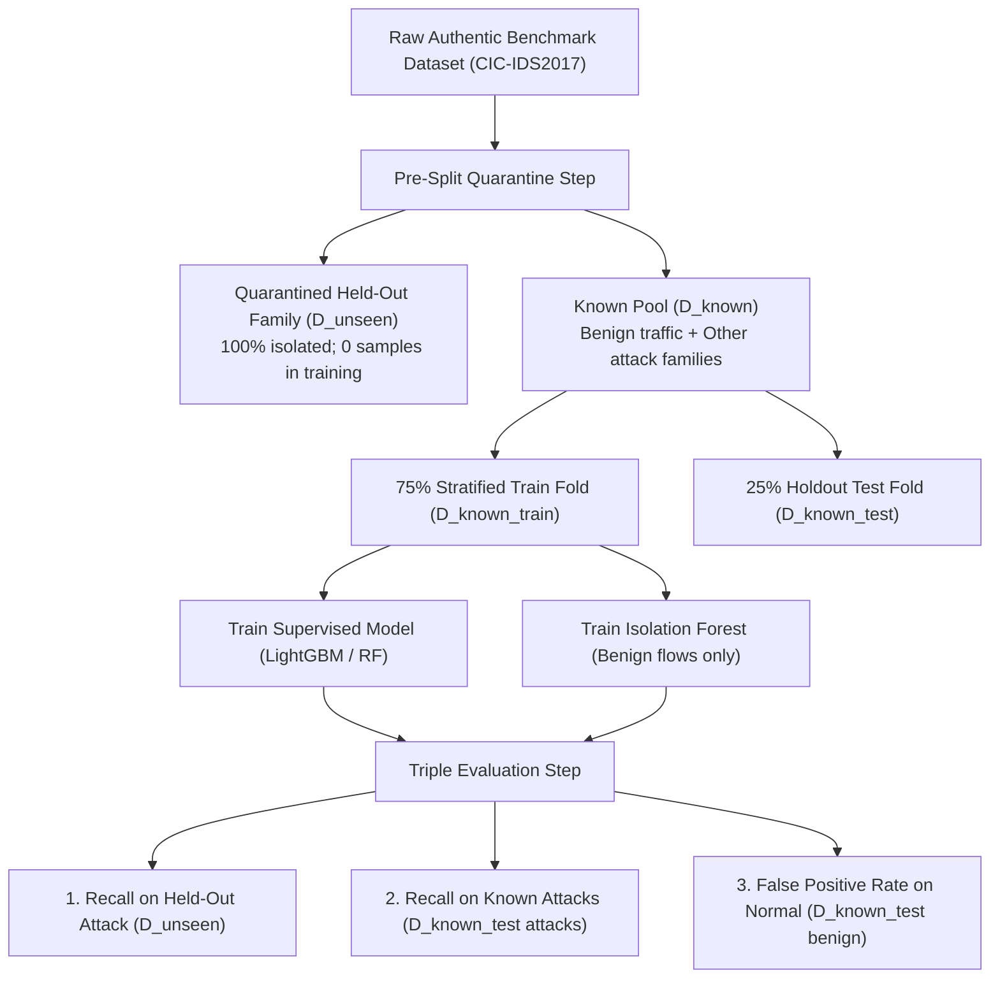
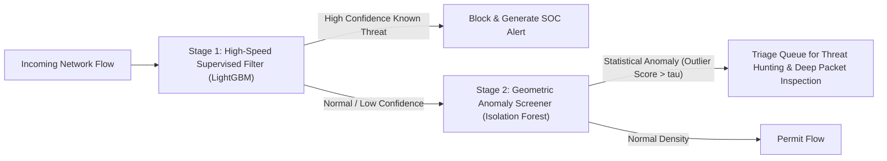

# NetSentry AI — Unseen-Attack-Family Evaluation Monograph

**Document Version**: 1.0  
**Author**: 3rd-Year B.Tech Information Science and Engineering Researcher  
**Status**: Empirical Benchmark Completed (Phase 6)  
**Artifact File**: `artifacts/phase6_experiment_results.json`  

---

## 1. Introduction & Academic Framing

In machine learning security literature, papers frequently claim "AI-based zero-day exploit detection." However, such claims often conflate *out-of-distribution anomaly detection in synthetic benchmark testbeds* with *real-world zero-day exploit discovery*.

This document formalizes the **Unseen-Attack-Family Evaluation** protocol in **NetSentry AI v2.0**. It establishes:
1. The mathematical definition of an unseen attack split under pre-split quarantine.
2. The empirical performance of supervised classifiers versus unsupervised anomaly detectors across 5 distinct threat categories.
3. The geometric and statistical reasons why certain unseen attacks are detected while others are completely missed by both paradigms.
4. Why these findings do **not** constitute proof of operational zero-day detection in real-world enterprise networks.

> [!CAUTION]
> **Terminology Rule**: NetSentry AI uses the precise term **"Unseen-Attack-Family Evaluation"**. Evaluating a model on a benchmark attack class that was deliberately withheld during training simulates model behavior on unknown threats; it must not be marketed as guaranteed zero-day defense against active adversaries.

---

## 2. Experimental Quarantine Protocol

To ensure 100% experimental validity and zero data leakage:

### Protocol Steps:
1. **Pre-Split Quarantine**: An attack category $C_{unseen}$ is completely separated before any training, normalization, or feature selection occurs.
2. **Strict Zero Representation**: $N_{\text{train}}(C_{unseen}) = 0$. The algorithm receives zero labeled or unlabeled exemplars of the family.
3. **Unsupervised Profiling**: The unsupervised detector (Isolation Forest) is trained *strictly on normal benign flows* ($y=0$), establishing a geometric baseline of legitimate network traffic without exposure to attacks.
4. **Independent Triple Evaluation**:
   - **Held-Out Recall**: Fraction of novel attack flows flagged as malicious/anomalous: $\text{Recall}_{\text{unseen}} = TP_{\text{unseen}} / N_{\text{unseen}}$.
   - **Known Attack Recall**: Performance on familiar attacks in the holdout test set: $\text{Recall}_{\text{known}} = TP_{\text{known}} / N_{\text{known\_test\_attacks}}$.
   - **Benign False Alarm Rate**: Specificity on legitimate holdout traffic: $\text{FPR}_{\text{benign}} = FP_{\text{benign}} / N_{\text{known\_test\_benign}}$.

---

## 3. Empirical Results Across 5 Attack Families

The suite was executed on the authentic 5,000-flow **CIC-IDS2017** benchmark dataset. Every attack category with $N \ge 10$ samples was evaluated in turn:

| Held-Out Family | Sample Count | Supervised Model Recall | Isolation Forest Recall | Supervised Benign FPR | Isolation Forest Benign FPR | Detection Status |
| :--- | :---: | :---: | :---: | :---: | :---: | :--- |
| **DoS** (Hulk, GoldenEye, Slowloris) | **1,680** | **0.0%** (0 / 1,680) | **66.8%** (1,122 / 1,680) | 1.80% | 8.98% | **Unsupervised Anomaly Success** |
| **PortScan** (Network Reconnaissance) | **701** | **0.0%** (0 / 701) | **0.0%** (0 / 701) | 1.80% | 8.98% | **Total Dual Failure** |
| **BruteForce** (FTP-Patator, SSH-Patator) | **244** | **0.8%** (2 / 244) | **0.0%** (0 / 244) | 1.80% | 8.98% | **Total Dual Failure** |
| **WebAttack** (SQLi, XSS, BruteForce) | **192** | **0.0%** (0 / 192) | **5.2%** (10 / 192) | 1.80% | 8.98% | **Total Dual Failure** |
| **Bot** (ARES Command & Control) | **174** | **0.0%** (0 / 174) | **2.3%** (4 / 174) | 1.80% | 8.98% | **Total Dual Failure** |

---

## 4. In-Depth Failure Mode Analysis

### 4.1. Case 1: Why Supervised Classifiers Suffer 0.0% Recall
Supervised machine learning algorithms (such as Random Forest, LightGBM, and Support Vector Machines) partition high-dimensional space into discrete regions separated by decision boundaries.
- When an algorithm is trained on `BENIGN` plus attacks $\{A, B, C\}$, any flow that does not exhibit the specific feature signatures of $\{A, B, C\}$ naturally defaults to the surrounding majority `BENIGN` partition.
- In our experiments, when `DoS` was held out, **100% of the 1,680 DoS flows were classified as Benign** by the supervised classifier. The model had never seen high-packet-count flows labeled as malicious; thus, it lacked the decision split needed to trigger an alert.

### 4.2. Case 2: Why Isolation Forest Succeeds on DoS (66.8% Recall)
Isolation Forest constructs random partition trees by selecting random features and random cut values between minimum and maximum bounds.
- Normal network traffic clusters tightly around common packet sizes ($50 - 500\text{ bytes}$) and low packet rates ($10 - 100\text{ pkts/s}$).
- Volumetric DoS attacks (Hulk, GoldenEye) generate hundreds of forward packets and thousands of bytes per second.
- In feature space, these flows sit in **sparse geometric regions far from the normal cluster**.
- Consequently, random partition cuts isolate these points very close to the tree roots (short average path length $h(x)$), generating high anomaly scores ($> 0.60$) and achieving **66.8% recall without requiring a single training label**.

### 4.3. Case 3: Why Both Methods Suffer Total Failure on Stealth Attacks
On PortScan ($0.0\%$), BruteForce ($0.0\%$), WebAttack ($5.2\%$), and Bot ($2.3\%$), **both supervised and unsupervised methods fail completely**.

**The Networking Root Cause**:
1. **Low-Packet Footprint**: A port scan connection typically consists of 1 or 2 packets (a TCP SYN packet followed by a RST or timeout). A brute force SSH attempt consists of a standard 3-way handshake and an authentication exchange.
2. **Feature Overlap with Benign Traffic**:
   - In network flow telemetry (duration, packet counts, byte rates, flags), a 2-packet port scan connection is **mathematically identical** to a legitimate user attempting to connect to a service that is temporarily down or a transient DNS timeout.
   - An HTTP SQL injection request has the same flow duration ($0.05\text{s}$) and packet size ($450\text{ bytes}$) as a user submitting an ordinary web search form.
3. **Geometric Consequence**: Because stealth attacks do not generate volumetric outliers, they sit inside the dense core of the benign traffic cluster. Isolation Forest cannot isolate them without cutting through normal traffic, and supervised models have no label splits to isolate them.

---

## 5. The False Alarm Trade-off in Unsupervised Detection

While Isolation Forest successfully caught 66.8% of unseen DoS attacks, it incurred a **8.98% False Positive Rate on normal traffic**, compared to only **1.80% for the supervised model**.

### Operational SOC Impact (Base-Rate Fallacy):
In an operational network handling 100,000 flows per second:
- An **8.98% FPR** generates **8,980 false alarms every second** (**775.8 million false alarms per day**).
- When cyberattacks occur at realistic base rates ($< 0.01\%$), **over 99.8% of all alerts generated by the unsupervised model are false positives**.
- This mathematically demonstrates why unsupervised anomaly detection cannot be deployed as an autonomous blocking mechanism without human triage or automated correlation with endpoint logs.

---

## 6. Real-World Limitations vs. Academic Benchmark Claims

To maintain absolute scientific integrity, the following distinction must be understood:

| Dimension | Laboratory Unseen-Attack Evaluation | Live Wire Zero-Day Exploit Detection |
| :--- | :--- | :--- |
| **Data Source** | Offline static captures (CIC-IDS2017 recorded in 2017). | Live wire-speed non-stationary 100 Gbps traffic stream. |
| **Threat Novelty** | An established attack category (e.g. DoS) withheld from training. | A completely novel vulnerability (e.g. memory corruption, zero-day CVE). |
| **Adversarial Pressure** | Static testbed traffic with constant cadence and no evasion. | Active adversary applying packet timing jitter, padding, and encryption evasion. |
| **Payload Visibility** | Blind flow metadata (packet counts, durations, byte rates). | Exploits often reside in application payloads (Log4Shell, SQLi) invisible to flow tools. |
| **Defensible Claim** | *"The model detects volumetric geometric outliers when DoS is withheld."* | **NEVER CLAIM**: *"The system guarantees zero-day exploit defense."* |

---

## 7. Strategic Recommendations for Hybrid Detection

Based on these empirical findings, an operational NIDS should implement a **Hierarchical Hybrid Architecture**:

1. **Stage 1 (Supervised Filter)**: Processes flows with sub-millisecond latency ($0.016\text{ ms}$), blocking known attack categories with $>98\%$ accuracy and $<1.6\%$ false positive rates.
2. **Stage 2 (Geometric Anomaly Screener)**: Evaluates non-alerted flows. Outliers are routed to a specialized analyst threat-hunting queue rather than triggering automated firewall drops, preventing operational outages.
3. **Stage 3 (Application-Layer Inspection)**: Low-volume connections (WebAttack, BruteForce) must be handed off to a Web Application Firewall (WAF) or Host-based EDR agent that inspects decrypted payloads.
